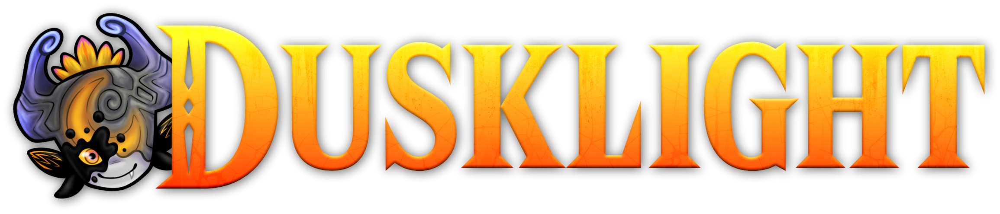

<h1 align="center">DuskLight 3DS</h1>

<p align="center">
  <strong>Twilight Princess. A native New Nintendo 3DS project.</strong><br>
  Experimental source port based on Dusklight.
</p>

<p align="center">
  <a href="#project-status">Status</a> ·
  <a href="#features">Features</a> ·
  <a href="#documentation">Documentation</a> ·
  <a href="CHANGELOG.md">Changelog</a> ·
  <a href="CONTRIBUTING.md">Contribute</a> ·
  <a href="#community-and-bug-reports">Community</a>
</p>

<p align="center">
  <a href="docs/STATUS.md"></a>
  <a href="docs/COMPATIBILITY.md"></a>
  <a href="docs/STATUS.md"></a>
  <a href="docs/legal/THIRD_PARTY_NOTICES.md"></a>
</p>

<p align="center">
  
</p>

<p align="center">
  <a href="[https://estebanpdn.github.io/](https://estebanpdn.github.io/dusklight.html)"></a>
  <a href="https://discord.gg/BjbzfRYpV"></a>
</p>

Native **New Nintendo 3DS** port work for *The Legend of Zelda: Twilight Princess*,
based on [Dusklight](https://github.com/TwilitRealm/dusklight) and the
[Twilight Princess decompilation](https://github.com/zeldaret/tp).

This project was developed with the help of [OpenAI Codex](https://openai.com/codex/). Learn more about the development process [here](AI_DEVELOPMENT.md).

**Experimental source publication in active development. No release or playable
binary is published.** The goal is a complete native port; full-game progression,
reliable save/reload and physical New3DS performance remain under development.

## Features

<table>
  <tr>
    <td width="50%" valign="top"><strong>Native ARM game integration</strong><br>Original game and JSystem code linked through a dedicated 3DS platform target.</td>
    <td width="50%" valign="top"><strong>GX on PICA200</strong><br>Native geometry, material, texture and framebuffer translation using Citro3D.</td>
  </tr>
  <tr>
    <td width="50%" valign="top"><strong>3DS platform services</strong><br>Circle Pad and C-Stick mapping, NDSP audio, SD data access and application diagnostics.</td>
    <td width="50%" valign="top"><strong>Inspectable development</strong><br>Source, synthetic host tests, pinned dependencies and maintained build and architecture guides.</td>
  </tr>
</table>

These are implemented development systems, with the validation limits described
in [Compatibility](docs/COMPATIBILITY.md). The 400×240, 2D, 30 Hz target is a goal;
sustained 30 FPS on physical hardware has not been established.

## Project status

This repository publishes the current source. **There is no GitHub release,
prerelease, installation QR or supported end-user download.** Build instructions
are available for developers in [Building](docs/BUILDING.md).

The port targets **New Nintendo 3DS, New Nintendo 3DS XL and New Nintendo 2DS XL**.
Old Nintendo 3DS and Old Nintendo 2DS are outside the current target.

A user-supplied **GameCube USA revision 0** game image (`GZ2E01`) is required for
runtime data preparation. No disc image, extracted game data, save or private
memory capture is included. See [Game data](docs/GAME_DATA.md).

## Documentation

| Guide | Purpose |
| --- | --- |
| [Documentation index](docs/README.md) | Start with the guide for your task. |
| [Repository map](docs/REPOSITORY.md) | Source ownership, directory layout and maintenance rules. |
| [Building](docs/BUILDING.md) | Toolchain, clean checkout, diagnostic and full integration builds. |
| [Architecture](docs/ARCHITECTURE.md) | Engine boundary, rendering, audio, storage and lifecycle. |
| [Compatibility](docs/COMPATIBILITY.md) | Target systems, implemented paths and remaining acceptance gates. |
| [Game data and controls](docs/GAME_DATA.md) | Local data preparation, SD paths, save format and input mapping. |
| [Configuration](docs/CONFIGURATION.md) | CMake options, profiles and experiment boundaries. |
| [Testing](docs/TESTING.md) | Synthetic host checks, target compilation and runtime evidence. |
| [Diagnostics](docs/DIAGNOSTICS.md) | Local reports, dump verification and useful bug reports. |
| [Verification status](docs/STATUS.md) | Checks performed for this source publication. |
| [Source provenance](docs/UPSTREAM.md) | Upstream pins, vendored changes and attribution. |

## Development

```sh
git clone https://github.com/EstebanPdN/dusklight-3ds.git
cd dusklight-3ds
python3 Tools/3ds/check_publication.py
python3 Tools/3ds/test_public_host.py
```

The source and pinned dependencies are included as ordinary files; a recursive
submodule download is not required. Host checks use Python 3 and a C++20 compiler
with AddressSanitizer and UndefinedBehaviorSanitizer. A target build also needs
devkitARM, libctru, Citro3D, CMake and the devkitPro 3DS tools.

<details>
<summary><strong>Build the native integration locally</strong></summary>

```sh
export DEVKITPRO=/opt/devkitpro
export DEVKITARM="$DEVKITPRO/devkitARM"
python3 Tools/3ds/build_public.py --profile game
```

Outputs stay in `Build/public-game/`. Building does not upload anything or create
a release. See [Building](docs/BUILDING.md) for the diagnostic profile, exact
configuration, prerequisites and current limitations.

</details>

## Community and bug reports

[Join the project Discord](https://discord.gg/BjbzfRYpV) for discussion and
[open a GitHub issue](https://github.com/EstebanPdN/dusklight-3ds/issues) for a
reproducible source problem. Include the commit, build profile, toolchain,
console or emulator version and concise reproduction steps.
See [Diagnostics](docs/DIAGNOSTICS.md) before sharing captures.

## Credits

- [Twilit Realm and Dusklight contributors](https://github.com/TwilitRealm/dusklight) — upstream reimplementation.
- [zeldaret/tp](https://github.com/zeldaret/tp) and the GameCube/Wii decompilation community — reconstructed engine and research.
- [Aurora contributors](https://github.com/encounter/aurora) — GX compatibility and native integration foundations.
- [devkitPro](https://devkitpro.org/) — devkitARM, libctru and Citro3D.
- [Cellenseres / OpenDSP](https://github.com/Cellenseres/OpenDSP) — open-source NDSP component.
- Esteban PDN — New Nintendo 3DS adaptation, project artwork and maintenance, with help from Codex.
- Nintendo — the original game and its associated names and content.

Full dependency scope is in [Third-party notices](docs/legal/THIRD_PARTY_NOTICES.md).
This is an independent fan project and is not affiliated with or endorsed by
Nintendo or Twilit Realm. Upstream project links identify the original authors;
the 3DS adaptation and its development process are maintained independently.

## License and legal notice

Dusklight and original port contributions follow the upstream
[CC0 1.0 dedication](LICENSE.md). Dependencies retain their own licenses and
notices; the root dedication does not relicense them or Nintendo game content.
See [Third-party notices](docs/legal/THIRD_PARTY_NOTICES.md) and
[Artwork](docs/images/README.md).

---

<p align="center">
  <a href="https://estebanpdn.github.io/">Esteban’s Forge</a> ·
  <a href="https://discord.gg/BjbzfRYpV">Discord</a> ·
  <a href="docs/README.md">Documentation</a> ·
  <a href="docs/legal/THIRD_PARTY_NOTICES.md">Credits and notices</a><br>
  <sub>Twilight Princess belongs to Nintendo. This is an independent fan project.</sub>
</p>
