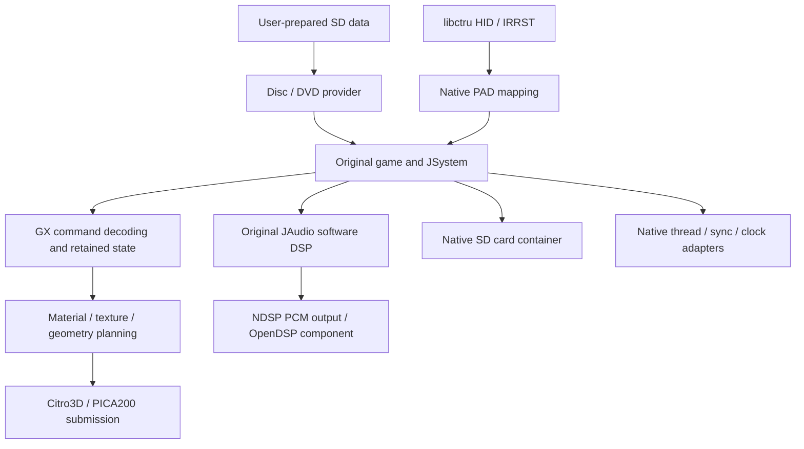

# Native architecture

The original game remains under `Source/src`, `Source/include` and
`Source/libs`. The adaptation is centered on `Source/platforms/3ds` and a small
set of shared platform guards. Aurora supplies selected command and math code;
the 3DS executable does not use the desktop Aurora GPU backend.

## Runtime flow

The diagnostic entry point and original-game startup are separate CMake
configurations, not evidence of equivalent functionality.

## Entry points and build boundaries

- `main.cpp` owns the native application loop and platform initialization.
- `runtime/game_startup.cpp` integrates the original machine/process startup.
- `runtime/bootstrap.cpp` and `scene_bootstrap.cpp` retain the earlier scoped
  bootstrap and scene diagnostic paths.
- `compile/*.json` enumerate original translation units used by kernel,
  environment and complete gameplay link gates.
- `DUSK_TARGET_3DS` and `__3DS__` distinguish native code from desktop code;
  `TARGET_PC` is also used by the selected reconstructed source ABI.

## Rendering

`gx_api.cpp` and `gx_command_api.cpp` expose compatibility entry points.
`runtime/gx_commands*`, `gx_stream*`, `gx_*_commands*` and Aurora's selected
GD/display-list helpers preserve command order and retained GX state.

Material decoding and PICA planning live in `runtime/gx_material*`,
`gx_pica_material*`, `gx_raster*`, `gx_pica_math*` and `gx_pica_tev*`.
Geometry decoding, clipping, transform and reuse code lives in `runtime/gx_vertex*`,
`gx_rigid*`, `gx_geometry*` and `gx_gpu_geometry*`. GPU submission is in the
platform `gx_*_pica.cpp` files and the `.v.pica` vertex programs.

Texture conversion is in `runtime/texture_*`, command/cache ownership in
`gx_texture_*` and `texture_resources*`, and framebuffer/copy lifetimes in
`gx_framebuffer*`, `gx_copy*` and `gx_gpu_sync*`. PICA texture sizes, tiled
layouts, alpha behavior and float precision require explicit validation.
Unsupported or unsafe state must remain diagnosable; scene-specific geometry
omission is not a general rendering fix.

## Memory and ownership

The native startup defines separate libc, linear and original JKR allocations.
The development configuration uses an 80 MiB libc heap, 16 MiB linear heap and
a 48 MiB JKR arena within that plan; nested arena sizes must not be added as
independent physical allocations. These are configured budgets, not measured
high-water use or proof of hardware headroom.

Disc/file handles are generation-bound. The DVD provider has exclusive loading
ownership; other threads consume published status rather than sharing an
unprotected `FILE`. Texture/cache objects must retain their backing bytes until
all relevant GPU consumers are complete. GPU completion and worker termination
precede destruction of memory they may still access.

## Audio, input and persistence

`runtime/audio_ndsp.cpp` connects original JAudio PCM to NDSP. OpenDSP is supplied
as a persistent component before NDSP initialization. Diagnostic PCM capture
observes pre-device samples, so it cannot prove audible speaker output.
`runtime/pad_native.cpp` consumes the once-per-tick HID/IRRST snapshot and maps
it with `pad_mapping.cpp`; it does not scan twice and consume input edges.

`runtime/card.cpp` preserves the game's save payload in a native `DSVCARD1`
container. Writes stage a replacement and rename it after flushing; the code
does not first remove the valid save. End-to-end story save/reload remains a
separate acceptance gate. [Game data](GAME_DATA.md) lists the exact paths.

## Lifecycle and diagnostics

`os_thread*`, `os_sync*`, `thread_backend*`, `primitives*`, `os_time*` and
`video_retrace*` bridge the original threading and timing APIs. Completion,
cancellation and fatal GPU failure are distinct paths. Review these adapters
together with their host substitutes before changing ownership or shutdown.

Application dumps and bounded PCM capture are developer services. Their output
is local diagnostic data, not a distributable source artifact. See
[Diagnostics](DIAGNOSTICS.md) for coherence limits and reporting.
