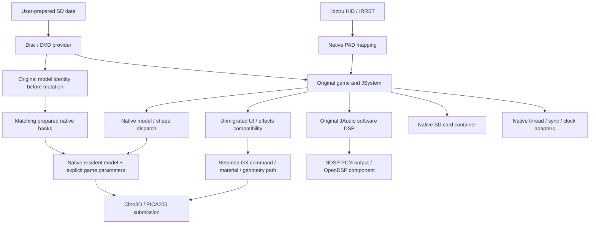

# Native architecture

The original game remains under `Source/src`, `Source/include` and
`Source/libs`. The adaptation is centered on `Source/platforms/3ds` and a small
set of shared platform guards. Aurora supplies selected command and math code;
the 3DS executable does not use the desktop Aurora GPU backend.

## Runtime flow

The diagnostic entry point and original-game startup are separate CMake
configurations, not evidence of equivalent functionality.

## Entry points and build boundaries

- `main.cpp` owns the native application loop and platform initialization.
- `runtime/game_startup.cpp` integrates the original machine/process startup.
- `runtime/bootstrap.cpp` and `scene_bootstrap.cpp` retain the earlier scoped
  bootstrap and scene diagnostic paths.
- `compile/*.json` enumerate original translation units used by kernel,
  environment and complete gameplay link gates.
- `DUSK_TARGET_3DS` and `__3DS__` distinguish native code from desktop code;
  `TARGET_PC` is also used by the selected reconstructed source ABI.

## Rendering

The default game model route is now the independent `native/` library, selected
by `DUSK_PICA_GAME_DRAW`. Prepared native resources and explicit game parameters
reach Citro3D without runtime GX decoding inside that module. The surrounding
engine migration is unfinished: see [Native renderer](NATIVE_RENDERER.md), its
[API/format contracts](NATIVE_RENDERER.md#format-and-api-references), and
[ADR 0001](decisions/0001-native-renderer.md). Missing native assets/inputs reject;
this route has no automatic old-model-renderer fallback. The diagram shows both
current paths and does not imply complete native asset or producer coverage.

The following compatibility sources remain for unmigrated callers:

`gx_api.cpp` and `gx_command_api.cpp` expose compatibility entry points.
`runtime/gx_commands*`, `gx_stream*`, `gx_*_commands*` and Aurora's selected
GD/display-list helpers preserve command order and retained GX state.

Material decoding and PICA planning live in `runtime/gx_material*`,
`gx_pica_material*`, `gx_raster*`, `gx_pica_math*` and `gx_pica_tev*`.
Geometry decoding, clipping, transform and reuse code lives in `runtime/gx_vertex*`,
`gx_rigid*`, `gx_geometry*` and `gx_gpu_geometry*`. GPU submission is in the
platform `gx_*_pica.cpp` files and the `.v.pica` vertex programs.

Texture conversion is in `runtime/texture_*`, command/cache ownership in
`gx_texture_*` and `texture_resources*`, and framebuffer/copy lifetimes in
`gx_framebuffer*`, `gx_copy*` and `gx_gpu_sync*`. PICA texture sizes, tiled
layouts, alpha behavior and float precision require explicit validation.
Unsupported or unsafe state must remain diagnosable; scene-specific geometry
omission is not a general rendering fix.

### Second-core worker

On a New 3DS the compatibility renderer draws on two cores (`runtime/gx_worker*`,
`runtime/gx_bank_delta.hpp`, the end of `gx_command_draw.cpp`). The game thread
walks the draw lists and runs the GX side of every packet on its own command
processor, which only stores registers. Where a shape would be drawn it is
queued instead: the words of the register bank that changed since the last
queued shape, the array bindings when they moved, the target extent, and the
shape itself (a J3D display list, or a run of primitive packets copied into the
queue). A thread on core 2 keeps a copy of the bank up to date from those
records and draws each shape as the game thread would have, by its native
records or by running its display list on a second processor.

- One thread at a time is the drawing side: it has the GPU, Citro3D and every
  table of the draw adapter. The game thread takes them back with a sync,
  which does not wait for the queue to empty: the worker stops after the shape
  it is drawing and the game thread draws the rest with the same code.
- Every path of the game thread that draws, touches the GPU or reads something
  a draw changes outside the register bank syncs first
  (`runtime/gx_worker_sync.hpp`). A function that checks the GPU owner before
  it works syncs through that check.
- GPU work that belongs between two shapes and whose result the game does not
  wait for is queued as a job and run in its place by the drawing side: the
  shadow caster pass, a frame copy that refreshes an existing image,
  `GXInvalidateTexAll`. As syncs these handed part of every picture's shapes
  back to the game thread.
- Shapes are queued only while the painter paints. Actors run after it, and
  they free and rewrite what a queued shape reads.
- The texture registry is read by both threads; its lookups change nothing and
  a registration becomes visible in one step (`runtime/gx_state.cpp`).

The build checks the second rule. [audit_shared_state.py](../Tools/3ds/audit_shared_state.py)
reads the object files of the image, lists every writable variable that both
the drawing side and the game thread can reach without a sync in between, and
stops the build when one has no verdict in `Tools/3ds/shared_state_judged.tsv`.
Three such variables had been found by a wrong picture before the tool existed;
its first run listed 298.

The worker is on by default and guarded: a start that had it on and ended on a
fatal error, a CPU exception or a GPU stop leaves it off from then on
(`gx-worker-learned.txt`); a fatal error or GPU stop met on the worker is
handed to the main thread, which ends the program as for its own; the
automatic test measures every zone once more with the worker off (phase
`onecore`). The builds of the owner's console runs from Alpha 10 on have it
on by default; what those runs showed is in [Verification status](STATUS.md).

Since Alpha 15 the worker's share reaches past the painter
(`gx-overlap.txt`, default `2`): the 2D passes are queued too (the HUD tape as
jobs), the painter ends without a sync and the worker draws on while the game
thread runs the next logic tick. Game code that frees, creates or rewrites what
a queued shape reads (heap frees and resets, process creation and deletion,
CPU-skinned vertex swaps) syncs first, and the picture's close syncs. The record
ring is 1 MiB; a full ring hands the game thread only what it needs for the
next record to fit.

### Performance improvements behind switches

From Alpha 21 every improvement that changes what is drawn or computed has a
switch in `runtime/perf_features.hpp`: `lod`, `shadow`, `skin`, `vertex`,
`mips`, `logic` and `paint`. Code asks `features::on(Id)` at the moment it
decides, never once at load, so the switches can change between two pictures
(on the game thread, with the worker idle). With a switch off the code takes
exactly the path it took before the improvement existed. All are on except
`mips`. A session's choice comes from `features.txt`; a measurement turns all of
them, or one of them, off for its own pictures; the STATS page of the bottom
screen turns them all off and on (with an emulator save state: the same game
frame with and without them).

- **Levels of detail** (`lod`, `shadow`; `runtime/model_lod*`,
  `include/d/d_native_lod.h`). `Tools/3ds/model_lod.py` makes `zelda.lod` on
  the Mac from the owner's own `zelda.twilight`. A level is another index list
  over the vertex records the runtime already makes for a batch of a display
  list, so no vertex is invented and the file carries no vertex data. Each
  model record is keyed by a fingerprint of its display lists, and every list
  and batch is checked again by hash and size: a record that does not describe
  what the runtime draws is never used. The game thread looks up a model's
  levels when the model is first entered; the drawing side swaps the index list
  of a recorded batch for the level's. A far shape takes the coarsest level
  whose error stays under 0.75 pixel (never Link, never an actor in an event);
  a shadow caster the coarsest under 0.75 pixel of its shadow tile. Without the
  file nothing changes.
- **Vertex program variants** (`vertex`; `runtime/gx_vertex_variant.hpp`).
  Four variants of the multi-texture vertex program sit beside it in the same
  shader binary (490 of the 512 words). The general program tests every path
  per vertex; a variant runs only the paths its kind of draw takes, with the
  same results. A change of variant sends no shader code.
- **Skinned matrix runs** (`skin`; `runtime/skin_palette.hpp`, `J3DShape.cpp`).
  Consecutive matrix groups of a skinned shape whose matrices fit become one
  draw that loads up to 20 matrices; exact for unweighted bones, and a weighted
  bone only while its normal stays within 4 degrees of J3D's, else that
  picture draws the groups the original way. A shape drawn at a reduced level
  of detail keeps its own groups.
- **Packet paint** (`paint`). Display-list replays answer held registers
  before the call, a vertex-setup list whose values and bindings are all in
  place is not run, and J3D's current matrix goes out as typed writes.
- **Far logic** (`logic`). A fish that the last picture culled, swims calmly,
  is over 3000 units from the player and has no rod or frog near does not run,
  as the game's own NOEXEC actors. It changes which random numbers the game
  draws afterwards.
- **World mip levels** (`mips`, off; `runtime/gx_world_mips.hpp`). Levels made
  at conversion for world textures authored without them, used only for plain
  world-model samples in perspective. Off because the picture changes where it
  can be seen.

Older exact cuts keep their own switches: the game-logic rules of
`include/d/d_native_logic.h` (`logic.txt`: process and actor lookup tables,
skin products, GameCube maths estimates, the twilight mist, collision
pre-tests and replays, the display-list writer), instance batches for repeated
models (`J3DNativeInstances.h`, `batch-instances.txt`), and the level-of-detail
rules of `lod.txt`.

### Native packets and PICA blocks (off by default)

`runtime/native_packets.hpp` captures a J3D material packet's register work
into one queue record that the worker runs on its copy of the bank, so the game
thread stops parsing, comparing and hashing those lists. `runtime/pica_blocks.hpp`
keeps the PICA command words of a recorded shape and sends them again, with
only the matrix palette rows rewritten, when every input of the block is proven
unchanged. Both are exact under their verify modes and both are off: in the
built-in emulator every thread shares one core and each was slower than the
path it replaces ([Verification status](STATUS.md), Alpha 12 and Alpha 14).
`native-packets.txt` and `pica-blocks.txt` turn them on.

### Zone transitions

`runtime/scene_transition.*` (Alpha 12) keeps the curtain closed until a new
zone is ready. The overlap does not send its out request while anything is
being created or the DVD thread has work (1 s without progress or 10 s in all
release it); then the scene runs one logic tick per picture behind an opaque,
frozen fader with the sound paused until two pictures in a row are steady
(45 pictures or 4 s at most). The original fade-in then plays its full length
with the game clock reset. `transition-hold-off.txt` restores the original
reveal.

### Pre-converted textures (built, not used)

`runtime/pretexture_store.*` reads PICA-ready images that
`Tools/3ds/pretexture_pack.py` appends to `zelda.twilight`; the key is computed
from the bytes the runtime already holds, and a store made by another decoder
version is refused. Alpha 12 found that the console would load them slower
(3.5 times the bytes at 0.63 MB/s), so the store is not linked into the game:
the Mac tools and their tests use it, and the runtime decodes textures as
before.

## Memory and ownership

The native startup defines separate libc, linear and original JKR allocations.
The development configuration uses an 80 MiB libc heap, 16 MiB linear heap and
a 48 MiB JKR arena within that plan; nested arena sizes must not be added as
independent physical allocations. These are configured budgets, not measured
high-water use or proof of hardware headroom.

Disc/file handles are generation-bound. The DVD provider has exclusive loading
ownership; other threads consume published status rather than sharing an
unprotected `FILE`. Texture/cache objects must retain their backing bytes until
all relevant GPU consumers are complete. GPU completion and worker termination
precede destruction of memory they may still access.

## Audio, input and persistence

`runtime/audio_ndsp.cpp` connects original JAudio PCM to NDSP. OpenDSP is supplied
as a persistent component before NDSP initialization. Diagnostic PCM capture
observes pre-device samples, so it cannot prove audible speaker output.
`runtime/pad_native.cpp` consumes the once-per-tick HID/IRRST snapshot and maps
it with `pad_mapping.cpp`; it does not scan twice and consume input edges.

`runtime/card.cpp` preserves the game's save payload in a native `DSVCARD1`
container. Writes stage a replacement and rename it after flushing; the code
does not first remove the valid save. End-to-end story save/reload remains a
separate acceptance gate. [Game data](GAME_DATA.md) lists the exact paths.

## Lifecycle and diagnostics

`os_thread*`, `os_sync*`, `thread_backend*`, `primitives*`, `os_time*` and
`video_retrace*` bridge the original threading and timing APIs. Completion,
cancellation and fatal GPU failure are distinct paths. Review these adapters
together with their host substitutes before changing ownership or shutdown.

Application dumps and bounded PCM capture are developer services. Their output
is local diagnostic data, not a distributable source artifact. See
[Diagnostics](DIAGNOSTICS.md) for coherence limits and reporting.

`runtime/measured_dump.hpp` (Alpha 21) measures ordinary pictures in stages: a
few pictures not measured, then the process timers alone (each process
profile's execute and draw methods, the game thread painting its packets, the
GPU-owning thread drawing them; exclusive times), then optionally every named
section timer, then one draw per GPU command list so each draw is its own GSP
job, then one picture that lets those lists complete. A full dump, the
automatic test and `measure-at.txt` ask for measurements;
`Tools/3ds/measure_report.py` reads all three. Only the game thread touches
this state, at picture boundaries, and the worker's own trials never overlap a
measurement.
